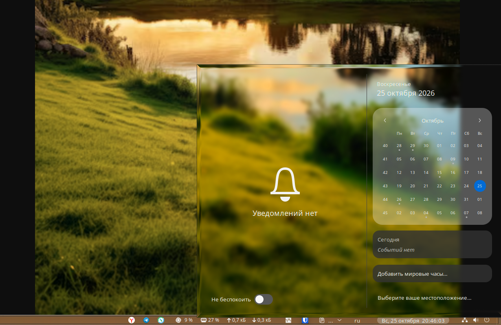
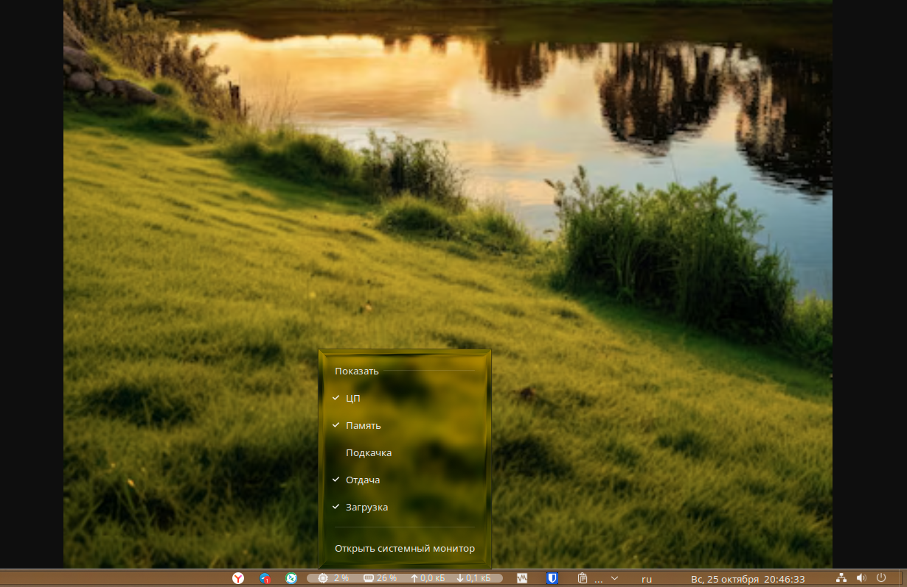
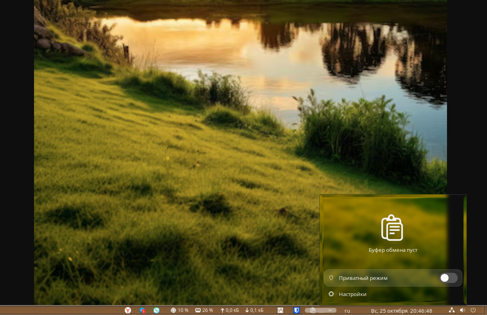
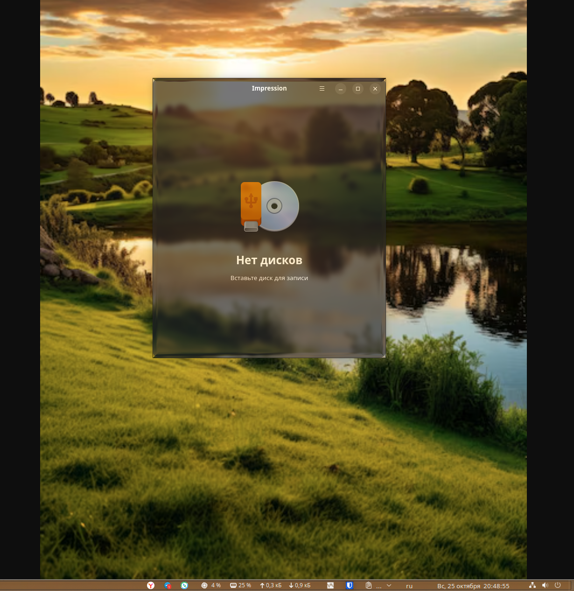

# Frosted Shell

Translucent frosted surfaces for GNOME Shell: the panel, menus, quick
settings, notifications and OSD float as tinted glass with a soft edge, and
application windows can let the desktop show through.

Developed and tested on **GNOME Shell 46 / Ubuntu 24.04 (X11)** with the
`dash-to-panel` layout. It is a theme plus a small amount of configuration —
no shell code of its own.

## What it looks like






| Surface | What changes |
| --- | --- |
| Panel | Thin translucent strip; buttons get soft rounded highlights |
| Menus / popovers | Rounded, semi-transparent slabs with a hairline border |
| Quick settings | Glass tiles, pill-shaped toggles, accent kept on active toggles |
| Notifications, OSD, dialogs | Floating frosted cards instead of opaque boxes |
| Application windows | Blurred backdrop, adjustable content opacity, rounded corners |

## Requirements

- GNOME Shell 46 (other versions: the CSS is written against the 46
  stylesheet API and is not guaranteed to load elsewhere)
- The Yaru theme, used as a base — `sudo apt install yaru-theme-gnome-shell`
- The User Themes extension — `sudo apt install gnome-shell-extensions`
- Optional, for the actual blur and refraction: the rendering engine fetched
  by `install.sh --with-effects` (see [NOTICE](NOTICE))

## Install

```bash
git clone https://github.com/vowa-antilamer/frosted-shell.git
cd frosted-shell

./install.sh                  # theme only: translucent surfaces
./install.sh --with-effects   # theme + blur/refraction engine + settings
```

Then restart the shell so the theme is loaded:

- **X11** — `Alt`+`F2`, type `r`, `Enter`
- **Wayland** — log out and back in

### What the two modes give you

`./install.sh` copies the base theme, appends `theme/overlay.css`, and points
*User Themes* at the result. Surfaces become translucent, tinted and rounded,
but nothing is blurred behind them: without an effect engine they simply show
what is behind.

`--with-effects` additionally installs the rendering engine that draws the
blur and the refraction, applies the settings snapshot in
`config/effects.dconf`, and turns off the parts of *Blur my Shell* that would
otherwise blur the same surfaces twice.

### Tuning

- Window transparency: the engine's preferences → **Application Windows →
  content opacity** (the shipped snapshot uses `0.62`)
- Tint colour and strength per surface: same preferences
- Panel opacity, radii and shadows: edit `theme/overlay.css` and re-run
  `./install.sh` — nothing else is touched

## Uninstall

```bash
./install.sh --uninstall                # theme removed, previous theme restored
./install.sh --uninstall --purge-effects # also delete the rendering engine

```

## Layout

```
install.sh              installer / uninstaller
theme/index.theme       metatheme entry (name, GTK/icon/cursor references)
theme/overlay.css       the stylesheet overrides (appended to the base theme)
config/effects.dconf    settings snapshot for the rendering engine
config/coexist.dconf    Blur my Shell settings that avoid double blurring
docs/                   screenshots
NOTICE                  third-party components and licensing
LICENSE                 GPL-3.0
```

## Notes and caveats

- **Do not run `killall -3 gnome-shell` to reload.** On a systemd session this
  is recorded as a crash and you get the "Oh no! Something has gone wrong"
  screen. Use `Alt`+`F2` → `r` on X11, or log out.
- `theme/overlay.css` stylesheet box-shadows accept a **single** shadow;
  comma-separated layers are silently truncated by GNOME Shell's CSS parser.
- The base theme's `gnome-shell/` directory is a symlink into the package.
  Copy it with `cp -rL`, otherwise you get a dangling link inside
  `~/.themes` — `install.sh` already does this.
- Rounded corners are drawn by the engine. If another extension rounds windows
  too, disable one of them or you get doubled radii.
- Transparency costs GPU time while dragging and scrolling. On a weak iGPU,
  raise the content opacity before anything else.

## Licence

GPL-3.0 — because the generated theme is a derivative of Yaru (GPL-3.0+).
Third-party components and their licences are listed in [NOTICE](NOTICE).
Not affiliated with, endorsed by, or sponsored by any vendor.
